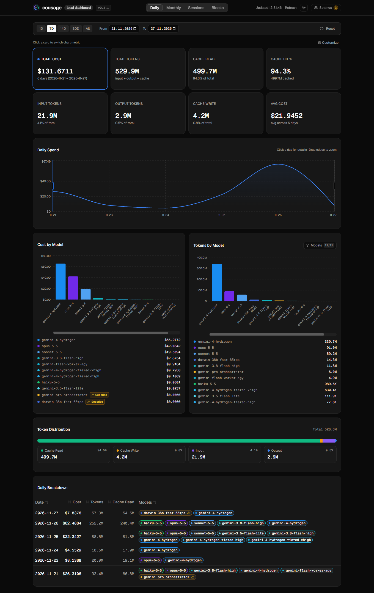
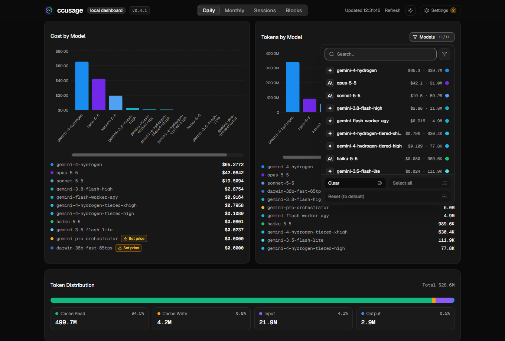
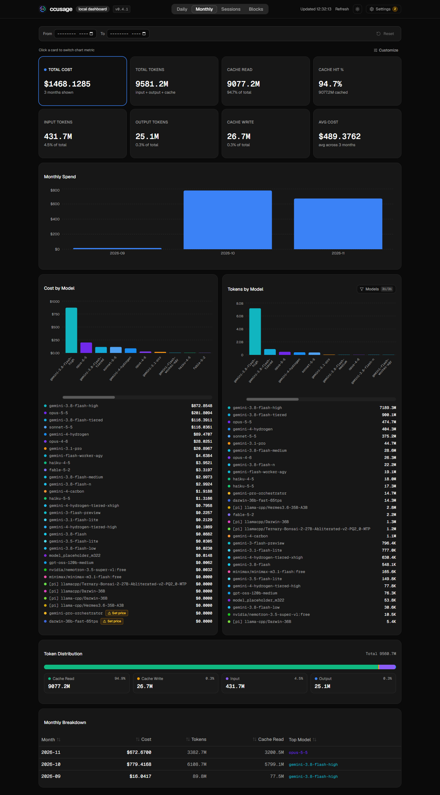
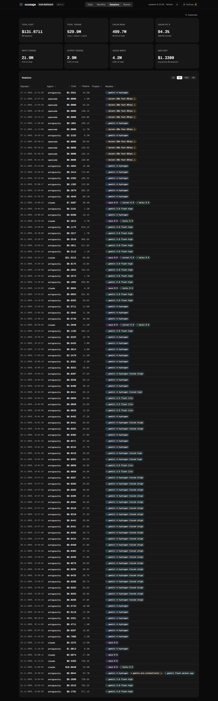
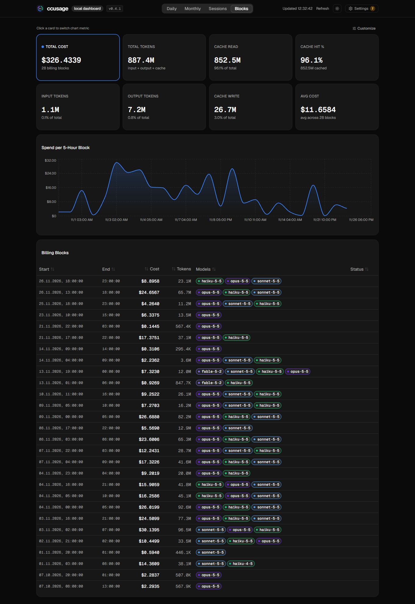
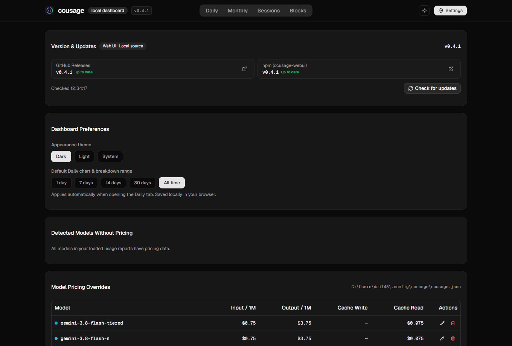

# ccusage-web

> Local web dashboard & Electron desktop app for monitoring **Claude Code** and **AI agent** token usage, API costs, and 5-hour billing windows — 100% private and local, no data leaves your machine.

Built on top of [`ccusage`](https://www.npmjs.com/package/ccusage). Track spending across **Daily, Monthly, Sessions, and 5-hour Billing Blocks** with interactive charts, per-model filtering, customizable KPI cards, custom pricing overrides, and automatic updates.

| Daily view (`7D`) | Model filter |
|-------------------|--------------|
|  |  |

| Monthly view | Sessions view (`7D`) |
|--------------|----------------------|
|  |  |

| Blocks view | Settings & Version updates |
|-------------|----------------------------|
|  |  |

## Features

- **4 interactive views** — **Daily**, **Monthly**, **Sessions** (multi-agent: Claude Code, Antigravity, OpenCode, etc.), and **5-hour Billing Blocks** with sortable tables and auto-refresh every 2 minutes.
- **8 customizable KPI cards** — **Total Cost**, **Total Tokens**, **Cache Read**, **Cache Hit %**, **Input Tokens**, **Output Tokens**, **Cache Write**, and **Avg Cost**. Drag and drop to reorder, hide/show cards, or click any card to switch the main chart metric.
- **Interactive date zoom & day inspection** — Quick presets (`1D`, `7D`, `14D`, `30D`, `All`), custom `From`/`To` inputs, click any day to drill down, or drag chart edge handles to zoom and pan.
- **Cost & Tokens by Model** — Side-by-side scrollable bar charts with color-coded model families (Claude, Gemini, OpenAI, open-weight/local models).
- **Model Filter** — Search models, filter by provider or active selection, toggle individual models, or `Clear` / `Select all` / `Reset (to default)`. Dynamically recalculates KPI cards, time-series charts, model charts, token distribution, and breakdown tables.
- **Token Distribution** — 100% stacked breakdown bar and cards for **Cache Read**, **Cache Write**, **Input**, and **Output** tokens.
- **Pricing Overrides & CLI Settings** — Detects models missing pricing (`Set price` badges), provides a pricing catalog lookup and per-1M token editor, `ccusage.json` raw editor, theme switcher (`Dark` / `Light` / `System`), and default Daily range preferences.
- **Auto-Updates & Install Detection** — Automatically detects how you run the app (Windows Installer, Portable, macOS, Linux AppImage, `npm`, `bun`, `pnpm`, `yarn`, `Volta`, `mise`, `npx`/`bunx`, or local source), checks GitHub Releases & npm, and supports one-click updates.

## Why a dashboard instead of the CLI?

| Capability | `ccusage` CLI | `ccusage-web` |
|------------|---------------|---------------|
| Spend & token trends | Static text table | Interactive area & bar charts with edge-drag zoom |
| Metric switching | Re-run with flags | Click any of the 8 KPI cards |
| Model comparison & filtering | `--breakdown` text rows | Scrollable Cost/Tokens charts + searchable model filter |
| Token type split | Raw columns | Stacked Token Distribution bar + percentages |
| Missing pricing fixes | Manual JSON editing | In-app catalog lookup & pricing override editor |
| Continuous monitoring | Manual reruns | Auto-refreshes every 2 minutes |

## Requirements

- **Desktop app (Electron)**: no prerequisites — bundles `ccusage` out of the box.
- **Web UI (`npm` / `bun` / `pnpm`)**: Node.js 18+ and usage data in `~/.claude/projects/` (or supported agent logs).

## Quick start (Web UI)

```bash
# Run directly without installing
npx ccusage-webui
# or with bun
bunx ccusage-webui

# Or install globally
npm install -g ccusage-webui
ccusage-webui
```

Your browser opens automatically at `http://localhost:4242`.

## Desktop app (Electron)

Download installers for **Windows** (`Setup .exe` with auto-update & `Portable .exe`), **macOS** (`arm64` & `x64` `.dmg`), and **Linux** (`.AppImage` with auto-update) from [GitHub Releases](https://github.com/dail45/ccusage-web/releases/latest).

```bash
npm run electron:dev       # run Electron against Next.js dev server
npm run electron:dist:dir  # unpacked desktop build for local testing
npm run electron:dist      # build installers into dist-electron/
```

- Bundles the native `ccusage` binary — no global CLI or `npx` required.
- Automatically checks GitHub Releases for updates (`electron-updater` on Windows NSIS & Linux AppImage; release link on Portable/macOS).
- Builds are unsigned, so Windows SmartScreen / macOS Gatekeeper may ask for confirmation on first launch.

### Releasing

```bash
npm version patch          # or minor / major — updates package.json and creates vX.Y.Z tag
git push origin main --follow-tags
```

Pushing a `v*` tag triggers [`.github/workflows/release.yml`](.github/workflows/release.yml), which builds Windows, macOS (`arm64` + `x64`), and Linux installers, publishes the GitHub release automatically, and publishes `ccusage-webui` to npm (when `NPM_TOKEN` is configured).

## Development

```bash
git clone https://github.com/dail45/ccusage-web
cd ccusage-web
npm install
npm run dev           # hot-reload dev server on localhost:3000
npm run typecheck     # TypeScript check
npm run screenshots   # re-capture docs/ screenshots (requires server running)
```

## How it works

Everything runs locally on your machine:
- `/api/usage` invokes `ccusage <view> --json` and normalizes daily, monthly, session, and billing-block entries.
- `/api/settings` reads and writes your `ccusage.json` configuration and pricing overrides.
- `/api/version` detects your installation method and checks GitHub Releases / npm for updates.

## Tech stack

- [Next.js 16](https://nextjs.org) · [React 19](https://react.dev) · [shadcn/ui](https://ui.shadcn.com) · [Recharts](https://recharts.org) · [Electron](https://www.electronjs.org) · [ccusage](https://www.npmjs.com/package/ccusage)

## Related

- [ccusage](https://github.com/ryoppippi/ccusage) — the CLI this dashboard is built on top of
- [Claude Code](https://claude.ai/code) — the AI coding tool whose usage this tracks

## License

MIT
